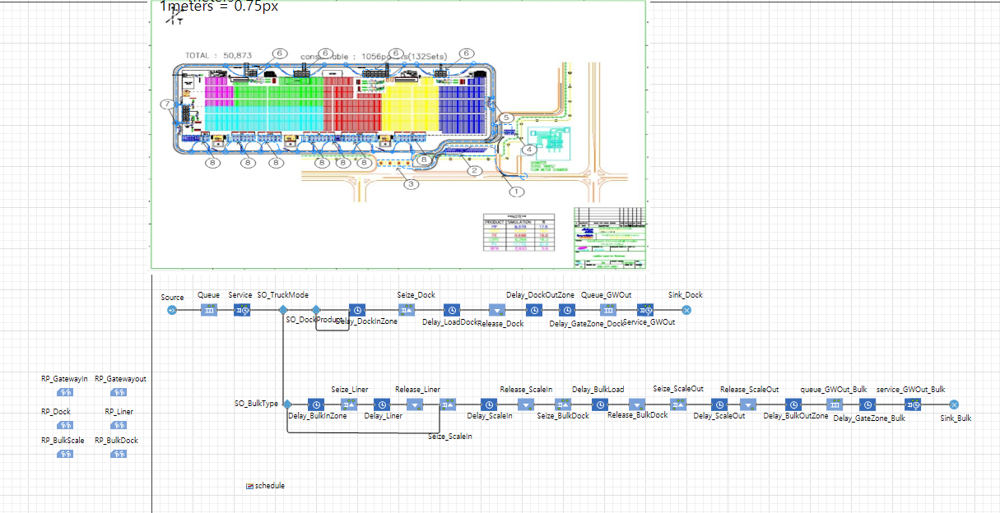

# Warehouse Outbound Process Simulation and Traffic Interference Optimization

## 1. Overview

This project uses AnyLogic to simulate warehouse outbound operations, identify bottlenecks, and analyze delays caused by vehicle traffic interference.

## 2. Objectives

- Analyze warehouse outbound process flows.
- Identify operational bottlenecks and traffic interference.
- Evaluate different operational scenarios to improve efficiency.

## 3. Simulation Methodology

- **Truck Arrivals:** Modeled using a Poisson distribution.
- **Process Duration:** Modeled using triangular distributions.
- **Product Mix Scenarios:** Compared 80:20 and 60:40 product mix ratios.
- **Traffic Management:** Evaluated gate-crossing traffic control and inbound/outbound route separation.

## 4. Key Findings

- Identified the gate merging area as a potential bottleneck.
- Evaluated traffic management scenarios to analyze their effects on total delay and vehicle interference.

## 5. Tools and Methods

- AnyLogic
- Discrete-Event Simulation (DES)
- Process Modeling
- Bottleneck Analysis
- Sensitivity Analysis

## Simulation Screenshots

### Simulation Model

### Simulation Running(1)
.png)

### Simulation Running(2)
.png)

## 6. Project Files

- `WarehouseSimulation.alp`: AnyLogic simulation model.
- `images/`: Simulation screenshots and result visualizations.

## 7. How to View the Model

Open the `.alp` file using a compatible version of AnyLogic.

Note: The model may require additional data files, libraries, or configuration depending on the project setup.
